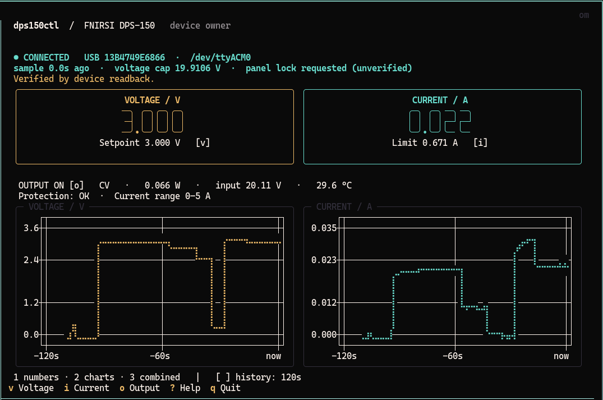

# dps150ctl

A Linux command-line tool, live terminal dashboard, and Python driver for the
**FNIRSI DPS-150**. Read measurements, adjust setpoints, log data, and share one
USB connection between a dashboard and scripts.



## Install and run

Python 3.11 or newer; a Unicode-capable terminal is recommended. From a checkout:

```bash
python3 -m venv .venv
.venv/bin/python -m pip install .
.venv/bin/dps150ctl tui --demo
.venv/bin/dps150ctl ports --json
.venv/bin/dps150ctl tui
```

Or install this checkout with `pipx install .` to put `dps150ctl` on your PATH.
`python -m dps150ctl` is equivalent to the console command. The project is
prepared for sharing but has not been published to a package registry.

`uv` is optional. Checkout launchers include PEP 723 inline dependencies:

```bash
uv run dps150ctl.py tui --demo
uv run dps150ctl.py status --json
```

`dps150.py` remains a compatibility launcher. Both launchers now use the same
new CLI. In particular, **commands now keep the panel locked on exit**, including
errors and Ctrl-C. Use `unlock` explicitly to release remote mode.

## Live dashboard

`dps150ctl tui` shows large measured voltage/current, separate setpoints,
output state, CV/CC, power, input voltage, temperature, protection status, and
scrolling voltage/current charts. The terminal UI uses
[Textual](https://textual.textualize.io/), its
[Digits widget](https://textual.textualize.io/widgets/digits/), and
[textual-plotext](https://github.com/Textualize/textual-plotext).
The dashboard and charts use your terminal's native background, including its
configured transparency, while retaining colored readings and borders.

| Key | Action |
| --- | --- |
| `v` / `i` | Enter voltage / current limit; Enter applies, Escape cancels |
| `o` | Toggle output, with readback verification |
| `1` / `2` / `3` | Numbers / charts / combined |
| `[` / `]` | 30-second / 2-minute / 10-minute chart history |
| `?` | Help |
| `q` / Ctrl-C | Quit, preserving power and panel lock |

The default is combined, with a two-minute window. Charts resize with the
terminal; small terminals use a compact display and offer the separate charts
view. Connection status, USB serial, current tty, sample age, voltage cap, and
errors remain visible. Old readings dim; missing data and reconnects leave
chart gaps. Panel locking is shown as *requested*, since no reliable lock-status
readback is known. The protection flag is separate from connection health.

Demo mode uses synthetic data and a private temporary service. It never opens a
serial port or connects to a production service. Its controls affect only the
simulation.

## One device, multiple clients

```bash
dps150ctl tui                         # owns the device or attaches to its service
# In another terminal:
dps150ctl status --json
dps150ctl set --voltage 0.42 --current 0.671

# Or run without a dashboard:
dps150ctl daemon run                  # stays in the foreground
dps150ctl daemon status --json
dps150ctl daemon stop
```

The dashboard and headless service expose the same private Unix socket. CLI
commands route through the owner. If there is no service, a command owns the
serial port directly until it finishes. A service timeout or disconnect never
causes a second connection or automatic retry of a write.

Quitting a dashboard that owns the device stops its service. Quitting a dashboard
attached to a separate service leaves that service running. `daemon stop`, Ctrl-C,
and normal owner shutdown leave output and setpoints alone and retain remote
panel locking. **Only explicit `output on` / `output off` change output enable.**

```bash
dps150ctl lock
dps150ctl unlock    # releases panel controls; also stops a running owner
```

Lock persistence after closing USB was visually confirmed on firmware V1.2.
Persistence across USB/power resets is not guaranteed. `--keep-locked` is still
accepted as a compatibility option and is now the default.

## USB identity and reconnection

```bash
dps150ctl ports --json
dps150ctl --device USB_SERIAL tui
dps150ctl --device USB_SERIAL status --json
dps150ctl --port /dev/ttyACM0 status
```

Connection options go **before** the subcommand. `DPS150_PORT` also selects a
path; `/dev/serial/by-id/…` paths work. `--device` selects the USB serial number,
which remains stable when `/dev/ttyACM0` becomes `/dev/ttyACM1`. Multiple candidate
devices require explicit selection. `ports` includes USB location and interface.

The service reconnects only to the same VID/PID/USB serial, verifies the model,
and reads fresh state. It never restores settings or enables output on
reconnection. Without a USB serial, explicit-port operation works but automatic
reconnection is disabled. The shared `2e3c:5740` ID identifies an Artery serial
bridge, **not a compatible family of power supplies**. Support is currently for
the DPS-150, verified originally with hardware V1.0 / firmware V1.2.

Serial settings are 115200 8N1, RTS/DTR asserted, without RTS/CTS. `--rtscts`
enables that flow-control option; `--timeout 3` changes the serial response timeout.

## Voltage cap

Use an optional cap when working with a low-voltage circuit:

```bash
dps150ctl --max-voltage 1.0 tui
dps150ctl --max-voltage 0.5 set --voltage 0.42
```

For persistence, put this in `~/.config/dps150ctl/config.toml` (or under
`$XDG_CONFIG_HOME`):

```toml
max_voltage = 1.0
```

`--config PATH` selects another file. The effective cap is the minimum of the
persistent cap, owner startup cap, optional client cap, device-reported limit,
and nominal 30 V limit. Flags and clients can tighten a cap, never raise the
owner's cap. To raise a persistent/startup cap, edit the configuration and restart
the owner. Current is limited by the device and nominal 5 A rating.

The UI displays allowed ranges. Every interface rejects negative/non-finite
values and validates all requested changes before writing. Current is written
before voltage; readback verifies the result. No nominal-resolution rounding is
imposed on float requests. Existing output above a newly chosen cap is reported,
not automatically changed; output-on is blocked until the setpoint is in range.
These are software command limits, separate from hardware protection thresholds.

A command that loses its response after transmission can have an **uncertain
outcome**. Errors report this explicitly; inspect fresh status before deciding
whether to issue another command. The tool never retries electrical writes.

## Extract information and capture data

```bash
dps150ctl info --json
dps150ctl status --json
dps150ctl read 0xc3 --json
dps150ctl stream > readings.jsonl
dps150ctl stream --format csv --interval 1 --count 60 > readings.csv

mkdir -p captures
dps150ctl capture --duration 10 --output captures/session.jsonl
dps150ctl decode captures/session.jsonl > captures/decoded.jsonl
dps150ctl --trace captures/status.jsonl status --json
```

`status` requests a fresh full-state block. JSON retains all decoded fields and
adds identity, connectivity, freshness and limits. CSV keeps the original main
measurement/limit columns. A missing snapshot is an error, not a repeated cached
row. Sample timestamps are host timestamps; floats preserve received precision.
`daemon status` reports cached state and freshness without issuing a device read.

Capture and `--trace` work through the service too. The requesting process writes
the file. Direct capture includes connection initialization; capture attached to
an existing owner starts at subscription time and includes shared device traffic.
A slow capture fails explicitly instead of silently dropping chunks. Files must
be new. `decode` is completely offline and reports malformed/discarded bytes on
stderr. With `--json`, operational errors use `{"error": {"code", "message",
"uncertain"}}` on stdout and a nonzero exit code; human errors use stderr.

`captures/` is an optional local folder for serial traces and debugging artifacts
from protocol investigation. It is ignored by Git and excluded from installation.
You can save captures elsewhere; normal operation does not require this folder.
Application code and installation resources live in the package.

## Serial permissions and systemd

Your user needs read/write permission on the serial device. A temporary grant is:

```bash
sudo setfacl -m "u:$(id -un):rw" /dev/ttyACM0
```

This applies only to the current node and disappears when unplugging recreates
it. The dashboard may correctly find the reconnected device but report
`Permission denied` until access is restored. It keeps retrying automatically.

Persistent access is part of the installed command. Preview the generated rule,
then install it once as administrator:

```bash
dps150ctl permissions show
sudo "$(command -v dps150ctl)" permissions install
```

From the unactivated checkout environment, use
`sudo .venv/bin/dps150ctl permissions install` instead. Under `sudo`, the target
account defaults to the invoking user (`SUDO_USER`); otherwise previews use the
current user. `--user NAME` selects another existing non-root account. When
running directly as root, specify `--user` explicitly. Run the dashboard as your
regular user.

The command automatically selects a single connected candidate. With multiple
devices, or to prepare access while a unit is unplugged, select its USB serial:

```bash
dps150ctl ports --json
sudo "$(command -v dps150ctl)" --device USB_SERIAL permissions install
```

The serial identifies an individual unit; `2e3c:5740` identifies the shared USB
bridge, not the supply model. No personal serial or username is built into the
package. The generated rule matches VID/PID and the selected serial, so it works
even if the tty number changes.

The installer and rule template ship in both the wheel and source distribution.
The command validates the rule when `udevadm verify` is available, installs it in
`/etc/udev/rules.d/`, reloads udev rules, and triggers a change event only for the
selected device if connected. Repeating the command is safe; conflicting files
and symlinks are refused. It does not open the serial port or write supply
settings. Installing the Python package itself does not change system permissions.

The rule runs `/usr/bin/setfacl` on add/change events, granting read/write access
to the selected user's numeric UID while retaining the normal owner/group.
Install the `acl` package if that executable is missing. This also works for
headless processes without an active desktop login. The rule persists across
unplugging and rebooting; the running service should reconnect within eight
seconds once access is available. A manual reference rule is also available in
[examples/70-dps150ctl.rules](examples/70-dps150ctl.rules).

[examples/dps150ctl.service](examples/dps150ctl.service) is an optional systemd
user-unit template. Set the executable path and USB serial before installing it
in `~/.config/systemd/user/`. Service installation is manual. Package installation
and normal control commands do not enable services or alter system configuration.

## Python API and development

```python
from dps150ctl import DPS150

with DPS150("/dev/ttyACM0", max_voltage=1.0) as supply:
    print(supply.snapshot())
    supply.close(keep_locked=True)
```

The low-level synchronous API owns a serial port directly and should be used only
when no service is running. Its original context-manager behavior releases the
remote session on exit; explicitly closing with `keep_locked=True` retains it.
For applications sharing an owner, use `dps150ctl.ipc.Client` with an `Endpoint`.
See [architecture and RPC](docs/architecture.md) and the observed
[wire protocol](PROTOCOL.md).

```bash
python -m pip install -e '.[dev]'
python -m pytest -q
ruff check .
python -m build
```

Tests use captured firmware V1.2 frames, simulated transports, real local Unix
sockets/PTYs, subprocesses, and Textual's headless Pilot. They block real hardware
access. The original driver was verified on an actual unit for voltage/current
writes, output-on, and panel lock; output-off and the new service/reconnect paths
are covered by simulation. No automatic test changes a connected supply.

Protocol research acknowledgments:
[nasheed-x/dps150_api](https://github.com/nasheed-x/dps150_api),
[cho45/fnirsi-dps-150](https://github.com/cho45/fnirsi-dps-150), and the
[manufacturer's DPS-150 page](https://www.fnirsi.com/products/dps-150).
The implementation includes the observed wire format and provenance in
`PROTOCOL.md`; it does not use an official FNIRSI SDK. MIT licensed.
