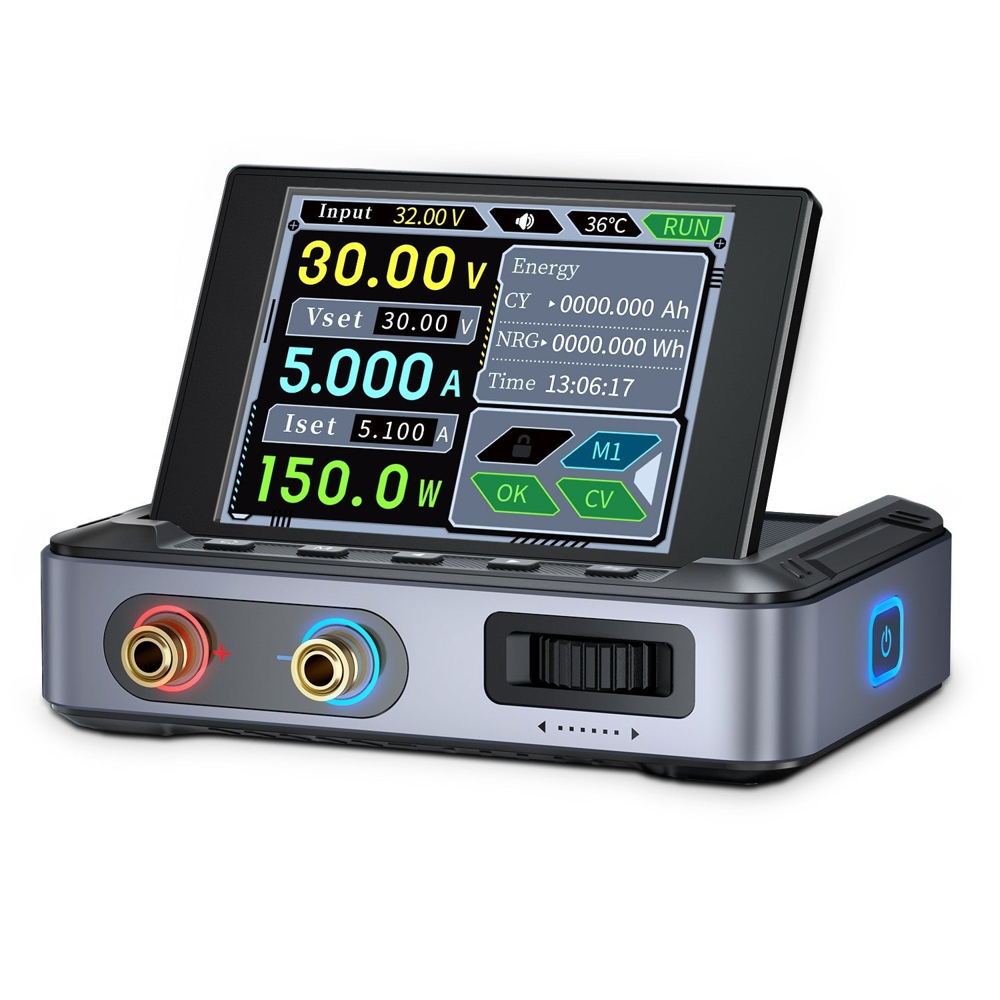

# Documentation

- [Architecture and local RPC](architecture.md)
- [Observed wire protocol](../PROTOCOL.md)

## Images

- [dashboard.png](dashboard.png): user-provided screenshot of the dashboard
  connected to a DPS-150, captured on September 27, 2026. Moved here unchanged
  and used as the main README's opening image.
- [dashboard.svg](dashboard.svg): synthetic dashboard example generated by
  [tools/screenshot_demo.py](../tools/screenshot_demo.py).
- [fnirsi-dps-150.jpg](fnirsi-dps-150.jpg): unmodified product image on a white
  background, downloaded September 27, 2026 from the
  [FNIRSI DPS-150 product page](https://www.fnirsi.com/products/dps-150)
  ([original image](https://www.fnirsi.com/cdn/shop/files/fnirsi-dps-150-mini-dc-adjustable-cnc-programmable-regulated-switching-power-supplypower-performancefnirsifnirsi-7382012.jpg?v=1751709903)).
  Product image copyright belongs to FNIRSI; it is not covered by this project's
  MIT code license.

